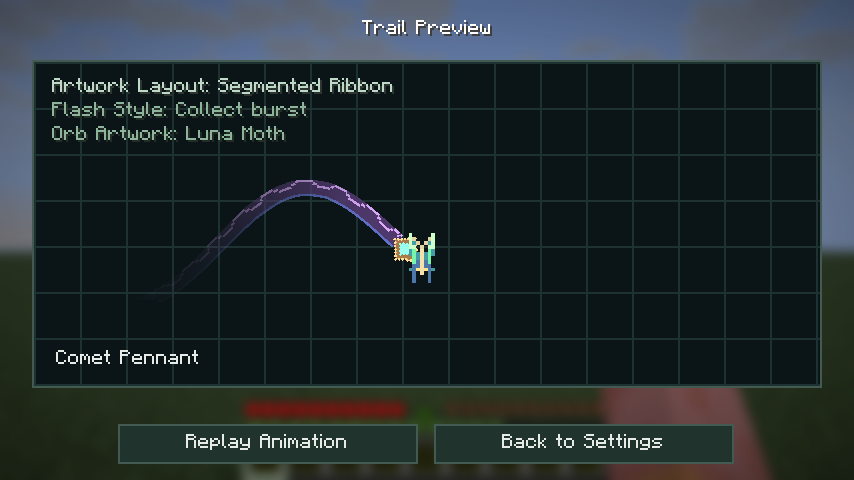

<h1 align="center"></h1>

<p align="center">Give Minecraft’s experience orbs a glowing trail, a new look in flight, and a flash when you collect them.</p>

<p align="center">
  <a href="https://modrinth.com/mod/xporbtrails"></a>
  <a href="https://github.com/GoldenEggOVO/xp_orb_trails/releases"></a>
  <a href="docs/advanced_customization.md"></a>
</p>

## In game

<p align="center">
  <a href="https://cdn.modrinth.com/data/cached_images/007599090538a98fda3fd67c1417d9876045502a.gif"></a>
  <a href="docs/images/comet_pennant_preview.png"></a>
</p>

The animation shows orbs in flight. To try the moth and its purple ribbon, open **Profiles → File Profiles** and select **Comet Pennant**.

- **Orb body** — Keep the familiar XP orb, layer an orbiting effect over it, or replace it with an animated sprite.
- **Trail** — Paint a ribbon with a gradient, shape a tube into a five-point star, or leave sprite stamps or afterimages along the flight path.
- **Pickup** — Finish with a soft glow, an expanding ring, or a burst of particles. Use **Effect Preview → Replay Animation** to watch the flight and pickup together.

<p align="center"></p>

## Installation

Install on your **Minecraft client** using Java 25 or newer. Choose one **2.0.0** JAR below and place it in your instance’s `mods/` folder. Fabric also requires [Fabric API](https://modrinth.com/mod/fabric-api).

| Minecraft | Fabric | Forge | NeoForge |
| --- | --- | --- | --- |
| [26.3](https://github.com/GoldenEggOVO/xp_orb_trails/tree/26.3) | [Fabric JAR](https://github.com/GoldenEggOVO/xp_orb_trails/releases/download/v2.0.0/xp_orb_trails-fabric-2.0.0%2B26.3.jar) | [Forge JAR](https://github.com/GoldenEggOVO/xp_orb_trails/releases/download/v2.0.0/xp_orb_trails-forge-2.0.0%2B26.3.jar) | [NeoForge JAR](https://github.com/GoldenEggOVO/xp_orb_trails/releases/download/v2.0.0/xp_orb_trails-neoforge-2.0.0%2B26.3.jar) |
| [26.2](https://github.com/GoldenEggOVO/xp_orb_trails/tree/26.2) | [Fabric JAR](https://github.com/GoldenEggOVO/xp_orb_trails/releases/download/v2.0.0/xp_orb_trails-fabric-2.0.0%2B26.2.jar) | [Forge JAR](https://github.com/GoldenEggOVO/xp_orb_trails/releases/download/v2.0.0/xp_orb_trails-forge-2.0.0%2B26.2.jar) | [NeoForge JAR](https://github.com/GoldenEggOVO/xp_orb_trails/releases/download/v2.0.0/xp_orb_trails-neoforge-2.0.0%2B26.2.jar) |
| [26.1 / 26.1.1 / 26.1.2](https://github.com/GoldenEggOVO/xp_orb_trails/tree/26.1) | [Fabric JAR](https://github.com/GoldenEggOVO/xp_orb_trails/releases/download/v2.0.0/xp_orb_trails-fabric-2.0.0%2B26.1.2.jar) | [Forge JAR](https://github.com/GoldenEggOVO/xp_orb_trails/releases/download/v2.0.0/xp_orb_trails-forge-2.0.0%2B26.1.2.jar) | [NeoForge JAR](https://github.com/GoldenEggOVO/xp_orb_trails/releases/download/v2.0.0/xp_orb_trails-neoforge-2.0.0%2B26.1.2.jar) |

<details>
<summary>Tested loader versions for Minecraft 26.3</summary>

| Loader | Tested version | Additional mods |
| --- | --- | --- |
| Fabric | Loader 0.19.5 | Fabric API 0.161.0+26.3; optional Mod Menu 21.0.0 |
| Forge | 66.0.9 | None |
| NeoForge | 26.3.0.52-beta | None; the tested loader is a Beta release |

</details>

## Configuration

Open **Config** in Mod Menu on Fabric, or the mod’s config button on the **Mods** screen on Forge and NeoForge. On any loader, you can also assign **Open Trail Settings** in Minecraft’s controls. Changes appear in the preview as you edit and are saved when you close the settings.

Choose **Profiles → Open Config Folder** to work with your own PNGs and JSON files. The player guide takes you from a first profile to a shareable look.

- [Make your first profile](docs/advanced_customization.md#make-your-first-file-profile)
- [Import a PNG or sprite sheet](docs/advanced_customization.md#bring-your-own-sprite)
- [Design a trail or map a ribbon texture](docs/advanced_customization.md#choose-how-a-trail-is-drawn)
- [Animate a pickup or emit particles](docs/advanced_customization.md#write-a-pickup-effect)

<details>
<summary>Two ready-to-edit effects — Prism Star and Double Burst</summary>

Save either example in `config/xp_orb_trails/pickup/effects/` as `prism-star.json` or `double-burst.json`. Select **Profiles → File Profiles → Reload Files**, then choose the effect on the **Pickup** page.

**Prism Star** rotates a six-point outline and shifts its color as it grows.

```json
{
  "version": 1,
  "name": "Prism Star",
  "layers": [{
    "shape": "radial",
    "radii": [1, 0.3, 1, 0.3, 1, 0.3, 1, 0.3, 1, 0.3, 1, 0.3],
    "easing": "smooth",
    "frames": [
      {"t": 0,    "color": "head",    "width": 0.5, "height": 0.5, "rotation": 0,   "opacity": 0.15},
      {"t": 0.35, "color": "#69F7FF", "width": 2.6, "height": 2.6, "rotation": 45,  "opacity": 1},
      {"t": 0.7,  "color": "#CE89FF", "width": 1.7, "height": 1.7, "rotation": 120, "opacity": 0.85},
      {"t": 1,    "color": "head",    "width": 0.5, "height": 0.5, "rotation": 180, "opacity": 0.15}
    ]
  }]
}
```

**Double Burst** sends two waves of diamond-shaped particles upward.

```json
{
  "version": 1, "name": "Double Burst",
  "emitter": {
    "bursts": [{"time": 0, "count": 12}, {"time": 0.25, "count": 6}],
    "lifetime": [0.5, 1.0], "speed": [0.8, 2.0], "size": [0.7, 1.2],
    "direction": [0, 1, 0], "spread": 65, "gravity": 3.0, "drag": 0.8
  },
  "layers": [{"shape": "diamond_xy", "frames": [
    {"t": 0, "width": 0.6, "height": 0.6, "color": "head", "opacity": 1},
    {"t": 1, "width": 0.2, "height": 0.2, "opacity": 0}
  ]}]
}
```

</details>

## Project links

[Changelog](CHANGELOG.md) · [Build from source and contribute](CONTRIBUTING.md) · [Report an issue](https://github.com/GoldenEggOVO/xp_orb_trails/issues) · [MIT License](LICENSE)

For visual issues with shaders, include the Minecraft version, loader, shader mod and shader pack in your report.

XP Orb Trails is an independent implementation and contains no Shine source code or assets.
