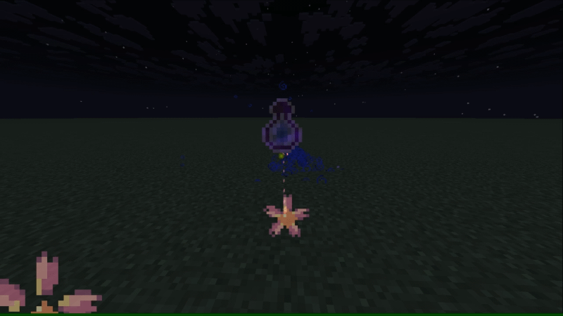
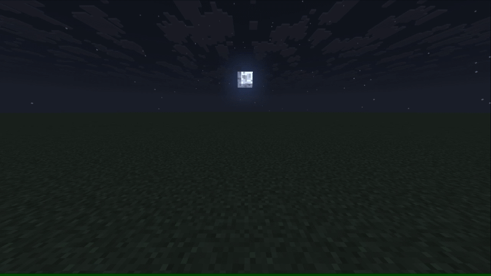
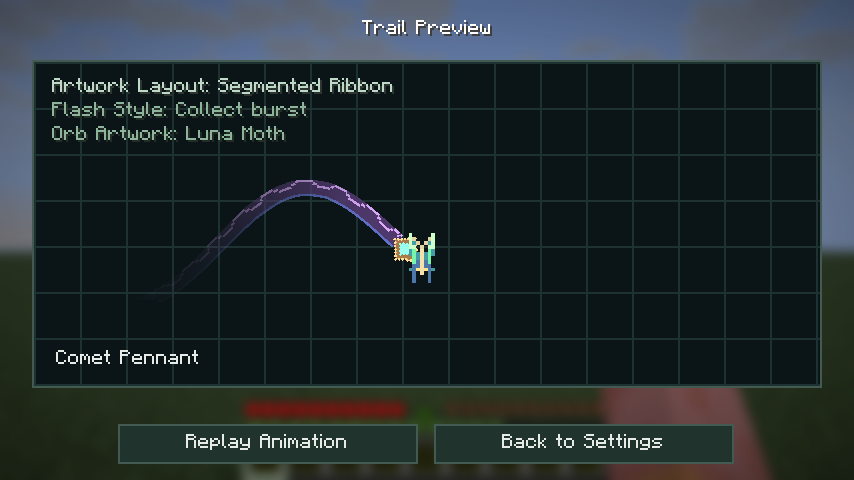

<a href="../README.md" lang="en">English</a>

  <picture>
    <source media="(prefers-reduced-motion: reduce)" srcset="images/orb_trails_banner.png">
    
  </picture>

  
  
  
  
  
  
  

## 关于 XP Orb Trails

经验球向你飞来时，会在空中留下一道发光的尾迹，并在拾取时绽开闪光。模组只需安装在客户端，单人世界和多人服务器都能使用。

## 可以自定义什么

- **经验球本体**：显示原版或资源包的经验球，也可以用绕行粒子、PNG 或逐帧动画替换它。
- **尾迹**：绘制双色渐变或动态彩虹，调整截面、给连续光带贴图，或沿飞行路径留下间隔可调的图案。
- **拾取效果**：从柔光和圆环开始，也可以让像素聚成蝶翼、让碎雪反弹，或在地上留下墨迹。打开**效果预览**可以重播飞行与拾取过程。

## 安装与兼容

使用 Java 25 或更高版本。按游戏版本和加载器**只下载一个 JAR**，放进当前游戏实例的 `mods/` 文件夹。Fabric 还需要 [Fabric API](https://modrinth.com/mod/fabric-api)。

| Minecraft | Fabric | Forge | NeoForge |
| --- | --- | --- | --- |
| [26.3](https://github.com/GoldenEggOVO/xp_orb_trails/tree/26.3) | [Fabric JAR](https://github.com/GoldenEggOVO/xp_orb_trails/releases/download/v2.1.0/xp_orb_trails-fabric-2.1.0%2B26.3.jar) | [Forge JAR](https://github.com/GoldenEggOVO/xp_orb_trails/releases/download/v2.1.0/xp_orb_trails-forge-2.1.0%2B26.3.jar) | [NeoForge JAR](https://github.com/GoldenEggOVO/xp_orb_trails/releases/download/v2.1.0/xp_orb_trails-neoforge-2.1.0%2B26.3.jar) |
| [26.2](https://github.com/GoldenEggOVO/xp_orb_trails/tree/26.2) | [Fabric JAR](https://github.com/GoldenEggOVO/xp_orb_trails/releases/download/v2.1.0/xp_orb_trails-fabric-2.1.0%2B26.2.jar) | [Forge JAR](https://github.com/GoldenEggOVO/xp_orb_trails/releases/download/v2.1.0/xp_orb_trails-forge-2.1.0%2B26.2.jar) | [NeoForge JAR](https://github.com/GoldenEggOVO/xp_orb_trails/releases/download/v2.1.0/xp_orb_trails-neoforge-2.1.0%2B26.2.jar) |
| [26.1 / 26.1.1 / 26.1.2](https://github.com/GoldenEggOVO/xp_orb_trails/tree/26.1) | [Fabric JAR](https://github.com/GoldenEggOVO/xp_orb_trails/releases/download/v2.1.0/xp_orb_trails-fabric-2.1.0%2B26.1.2.jar) | [Forge JAR](https://github.com/GoldenEggOVO/xp_orb_trails/releases/download/v2.1.0/xp_orb_trails-forge-2.1.0%2B26.1.2.jar) | [NeoForge JAR](https://github.com/GoldenEggOVO/xp_orb_trails/releases/download/v2.1.0/xp_orb_trails-neoforge-2.1.0%2B26.1.2.jar) |

## 常见问题

**支持光影吗？** 支持。反馈显示问题时，请注明游戏版本、加载器、光影模组和光影包名称。

**能使用改变经验球材质的资源包吗？** 可以。在**经验球本体**页启用原版经验球显示，就能看到资源包里的材质。

## 效果展示

  
  
  
  
  

在**方案 → 文件方案**里选择**彗尾飘带**，即可试用图中的月蛾与紫色光带。

## 设置与方案包

在 Fabric 上用 Mod Menu 的配置按钮打开设置。在 Forge 或 NeoForge 上从模组列表进入。三个加载器都可以在 Minecraft 的控制设置中为打开尾迹设置绑定按键。

安装方案时，打开**方案 → 打开方案包文件夹**，放入 ZIP，再点**文件方案 → 重新加载文件**并选择方案。编辑自己的 JSON 或 PNG 时，可在**通用 → 打开配置文件夹**找到对应目录。

- [下载示例并查看 ZIP 安装说明](../examples/README.zh-CN.md)
- [查看 24 套效果的触发条件](../examples/2.1.0example/README.zh-CN.md)
- [在中文 Wiki 中制作第一个方案](https://goldeneggovo.github.io/xp_orb_trails/wiki/zh-cn.html#make-your-first-file-profile)
- [查阅粒子发射器与图集参数](https://goldeneggovo.github.io/xp_orb_trails/wiki/zh-cn.html#tune-the-emitter)

[更新记录](../CHANGELOG.md) · [参与开发](../CONTRIBUTING.md) · [反馈问题](https://github.com/GoldenEggOVO/xp_orb_trails/issues) · [MIT 许可证](../LICENSE)
