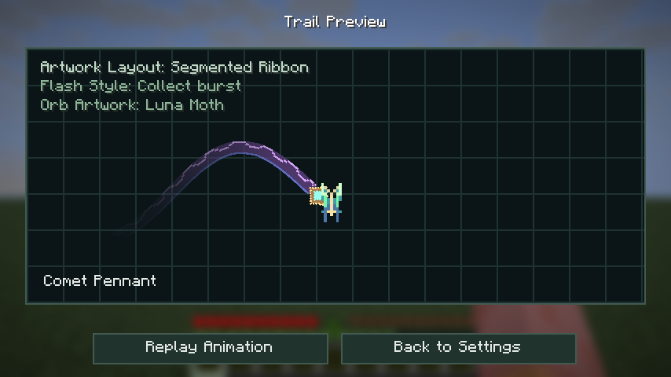

  
  
  
  

Experience orbs leave glowing trails as they fly toward you, then flash as you collect them. Install XP Orb Trails on your client to use it in singleplayer or multiplayer.

- **Orb body** — Keep the vanilla orb, add orbiting particles, or replace it with an animated sprite.
- **Trail** — Draw a gradient ribbon, give a tube a star-shaped cross-section, or leave a line of afterimages.
- **Pickup** — Try a soft glow, an expanding ring, or your own particle burst.

Choose a profile and replay it in the in-game preview. You can also create and share effects using PNGs and JSON.

**Minecraft 26.1–26.1.2, 26.2 and 26.3** · Fabric, Forge and NeoForge · Java 25 or newer. Fabric also requires [Fabric API](https://modrinth.com/mod/fabric-api).

**Does XP Orb Trails work with shaders?**

Yes, it supports shader packs.

**Can I use a resource pack that changes the XP orb texture?**

Yes. Leave **Show Vanilla Orb** enabled under **Orb Body** to see your resource pack’s texture.

