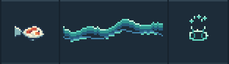
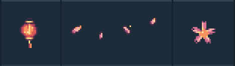
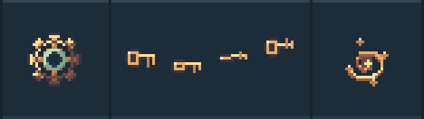

# Sprite sheet examples for XP Orb Trails 2.0.0

[Download the four sprite profiles](sprite_sheet_examples.zip?raw=1) or browse their editable files below. Starfall is included with the mod and its source is also available here.

**On 2.0.0**, extract the ZIP into your instance’s `config/xp_orb_trails/` folder, merging the role folders with the ones already there. Open **Profiles → File Profiles → Reload Files** and choose a profile. **On 2.1.0**, you can install the same ZIP directly using the [pack installation guide](../README.md).

The animated swatches below show the **orb**, **trail** and **pickup** artwork from left to right.

| Profile | Sprite preview | What to try |
| --- | --- | --- |
| [Koi Stream](koi_stream/config/xp_orb_trails/) |  | The koi is a horizontal PNG strip. The ribbon tiles a wave along the flight path. Change `ribbonRepeatLength` to put its crests closer together. |
| [Lantern Bloom](lantern_bloom/config/xp_orb_trails/) |  | A red lantern leaves petal stamps fixed in the world. Increase `stampSpacing` to scatter them farther apart. |
| [Brass Clockwork](brass_clockwork/config/xp_orb_trails/) |  | The orb uses a vertical strip. The pickup atlas gives each frame its own `duration` in milliseconds. Lengthen the middle frames to slow the spring as it opens. |
| [Ion Drive](ion_drive/config/xp_orb_trails/) |  | The ribbon descriptor reserves 7 pixels for the tail and 9 for the head. Only its middle section tiles along the path. |

To draw a replacement, edit a `sheet.png` in the role’s `sprites/` folder. Most sheets have a neighboring `sheet.json` that defines frame size, order and timing. Koi Stream’s orb demonstrates automatic square-frame detection and plays at 12 FPS using the PNG alone. After editing, reload files and select the profile again.

[Starfall](starfall/config/xp_orb_trails/) is a separate example for JSON particle emitters and a star-shaped trail. The [player guide](https://goldeneggovo.github.io/xp_orb_trails/wiki/) explains sprite sheets, texture mapping and sharing profiles.
